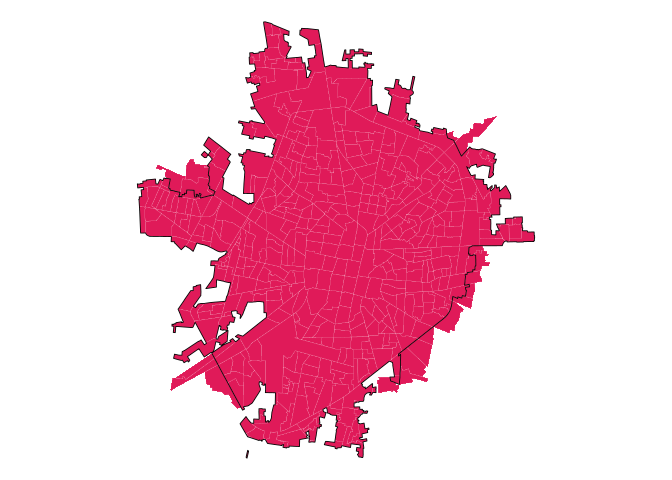
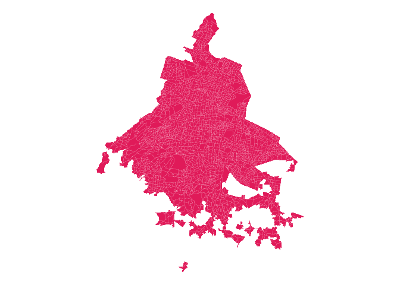

# Extraer AGEB

``` r

library(rgeomex)
library(ggplot2)
```

[`extract_ageb()`](https://fdzul.github.io/rgeomex/reference/extract_ageb.md)
extrae los AGEB que intersectan el polígono de una localidad. Tiene dos
argumentos: la clave del estado (`cve_edo`) y el nombre de la localidad
(`locality`). Regresa una lista con dos objetos sf: `locality` (el
polígono de la localidad) y `ageb`.

Solo se descarga el archivo del estado que se pide.

## Mérida

``` r

merida <- extract_ageb(cve_edo = "31", locality = "Merida")
nrow(merida$ageb)
#> [1] 498
```

``` r

ggplot() +
  geom_sf(data = merida$ageb, fill = "#E01A59", col = "white", lwd = 0.05) +
  geom_sf(data = merida$locality, fill = NA, col = "black", lwd = 0.3) +
  theme_void()
```



plot of chunk merida_map

## Guadalajara

``` r

gdl <- extract_ageb(cve_edo = "14",
                  locality = c("Guadalajara", "Zapopan", "Tonalá", "Tlaquepaque"))
nrow(gdl$ageb)
#> [1] 1270
```

``` r

ggplot() +
  geom_sf(data = gdl$ageb, fill = "#E01A59", col = "white", lwd = 0.05) +
  geom_sf(data = gdl$locality, fill = NA, col = "black", lwd = 0.3) +
  theme_void()
```


plot of chunk guadalajara_map

## Ciudad de México

``` r

cdmx <- extract_ageb(cve_edo = "09", locality = "cdmx")
nrow(cdmx$ageb)
#> [1] 2431
```

``` r

ggplot() +
  geom_sf(data = cdmx$ageb, fill = "#E01A59", col = "white", lwd = 0.05) +
  theme_void()
```



plot of chunk cdmx_map

## Con código

Los mismos pasos que hace la función:

``` r

# 1. la localidad
loc <- extract_locality(cve_edo = "31", locality = "Merida")

# 2. la base del estado
x <- rgeomex_load("AGEB_inegi_2019", cve_edo = "31") |>
  sf::st_make_valid()

# 3. lo que intersecta la localidad
x <- x[loc, ]
nrow(x)
#> [1] 498
```
