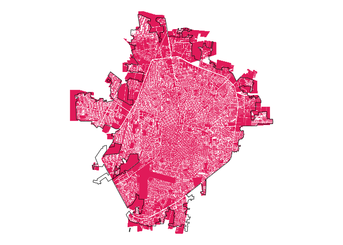
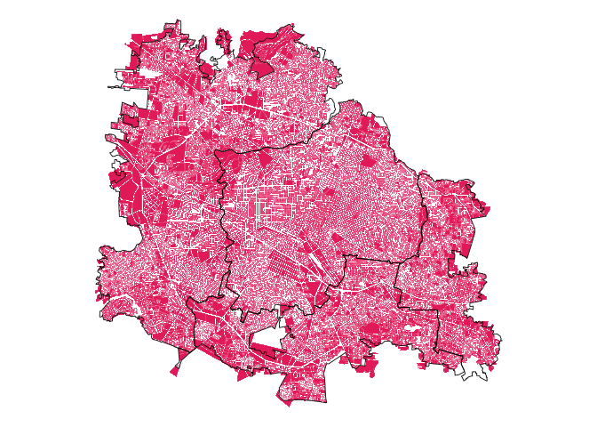
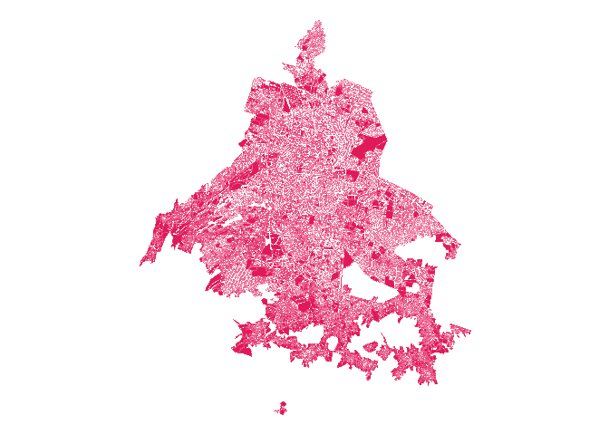

# Extract blocks

``` r

library(rgeomex)
library(ggplot2)
```

[`extract_blocks()`](https://fdzul.github.io/rgeomex/reference/extract_blocks.md)
extracts the blocks that intersect the boundary of a locality. It has
two arguments: the state key (`cve_edo`) and the name of the locality
(`locality`). It returns a list with two sf objects: `locality` (the
boundary of the locality) and `block`.

Only the file of the requested state is downloaded.

## Mérida

``` r

merida <- extract_blocks(cve_edo = "31", locality = "Merida")
nrow(merida$block)
#> [1] 15374
```

``` r

ggplot() +
  geom_sf(data = merida$block, fill = "#E01A59", col = "white", lwd = 0.05) +
  geom_sf(data = merida$locality, fill = NA, col = "black", lwd = 0.3) +
  theme_void()
```



## Guadalajara

``` r

gdl <- extract_blocks(cve_edo = "14",
                  locality = c("Guadalajara", "Zapopan", "Tonalá", "Tlaquepaque"))
nrow(gdl$block)
#> [1] 39830
```

``` r

ggplot() +
  geom_sf(data = gdl$block, fill = "#E01A59", col = "white", lwd = 0.05) +
  geom_sf(data = gdl$locality, fill = NA, col = "black", lwd = 0.3) +
  theme_void()
```



## Mexico City

``` r

cdmx <- extract_blocks(cve_edo = "09", locality = "cdmx")
nrow(cdmx$block)
#> [1] 76407
```

``` r

ggplot() +
  geom_sf(data = cdmx$block, fill = "#E01A59", col = "white", lwd = 0.05) +
  theme_void()
```



## Step by step

The same steps the function does:

``` r

# 1. the locality
loc <- extract_locality(cve_edo = "31", locality = "Merida")

# 2. the dataset of the state
x <- rgeomex_load("blocks_ine20_mx", cve_edo = "31") |>
  sf::st_make_valid()

# 3. what intersects the locality
x <- x[loc, ]
nrow(x)
#> [1] 15374
```
