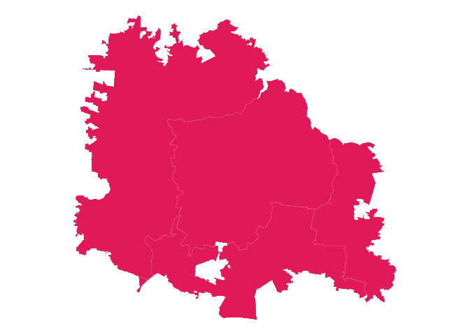
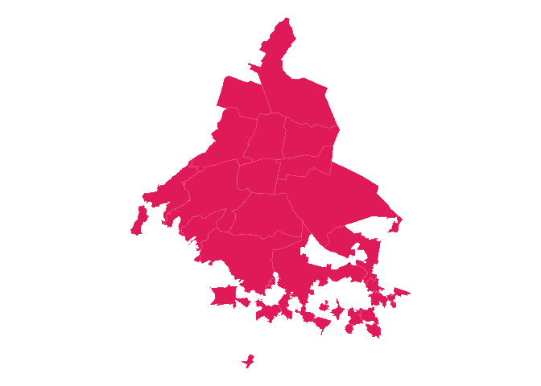

# Extraer localidades

``` r

library(rgeomex)
library(ggplot2)
```

Para extraer una localidad se usa
[`extract_locality()`](https://fdzul.github.io/rgeomex/reference/extract_locality.md),
con dos argumentos: la clave del estado (`cve_edo`) y el nombre de la
localidad según el INEGI (`locality`). No importan los acentos ni las
mayúsculas: se usa el nombre más parecido. La función regresa un objeto
sf.

Los polígonos se descargan la primera vez que se usan y se guardan en un
caché local
([`rgeomex_cache_dir()`](https://fdzul.github.io/rgeomex/reference/rgeomex_cache_dir.md));
las siguientes veces se leen del caché.

``` r

acapulco <- extract_locality(cve_edo = "12", locality = "Acapulco de Juarez")
acapulco
#> Simple feature collection with 1 feature and 6 fields
#> Geometry type: MULTIPOLYGON
#> Dimension:     XY
#> Bounding box:  xmin: -100.0048 ymin: 16.71173 xmax: -99.69626 ymax: 16.93538
#> Geodetic CRS:  WGS 84
#>      CVEGEO CVE_ENT CVE_MUN CVE_LOC             NOMGEO AMBITO
#> 1 120010001      12     001    0001 Acapulco de Juárez Urbana
#>                         geometry
#> 1 MULTIPOLYGON (((-99.69861 1...
```

``` r

ggplot() +
  geom_sf(data = acapulco, fill = "#E01A59", col = "white", lwd = 0.05) +
  theme_void()
```


El argumento `locality` acepta un vector con las localidades de una zona
metropolitana:

``` r

guadalajara <- extract_locality(cve_edo = "14",
                                locality = c("Guadalajara", "Zapopan",
                                             "Tlaquepaque", "Tonalá"))
guadalajara$NOMGEO
#> [1] "Guadalajara" "Tlaquepaque" "Tonalá"      "Zapopan"
```

``` r

ggplot() +
  geom_sf(data = guadalajara, fill = "#E01A59", col = "white", lwd = 0.05) +
  theme_void()
```



Para la Ciudad de México (`cve_edo = "09"`) se regresan todas sus
localidades:

``` r

cdmx <- extract_locality(cve_edo = "09", locality = "cdmx")
nrow(cdmx)
#> [1] 33
```

``` r

ggplot() +
  geom_sf(data = cdmx, fill = "#E01A59", col = "white", lwd = 0.05) +
  theme_void()
```



Las bases completas se cargan con
[`rgeomex_load()`](https://fdzul.github.io/rgeomex/reference/rgeomex_load.md);
[`rgeomex_datasets()`](https://fdzul.github.io/rgeomex/reference/rgeomex_datasets.md)
lista las disponibles:

``` r

rgeomex_datasets()
#>                     dataset by_state geometry
#> 1           AGEE_inegi19_mx    FALSE     TRUE
#> 2           AGEM_inegi19_mx    FALSE     TRUE
#> 3           AGEM_inegi25_mx    FALSE     TRUE
#> 4            loc_inegi19_mx    FALSE     TRUE
#> 5                    hrl_mx    FALSE     TRUE
#> 6                    pua_mx    FALSE     TRUE
#> 7                     ua_mx    FALSE     TRUE
#> 8             iter_2020_loc    FALSE    FALSE
#> 9           AGEB_inegi_2019     TRUE     TRUE
#> 10          blocks_ine20_mx     TRUE     TRUE
#> 11 blocks_ine20_mx_centroid     TRUE     TRUE
#> 12        sectores_ine20_mx     TRUE     TRUE
yucatan <- rgeomex_load("AGEM_inegi19_mx", cve_edo = "31")
nrow(yucatan)
#> [1] 106
```
