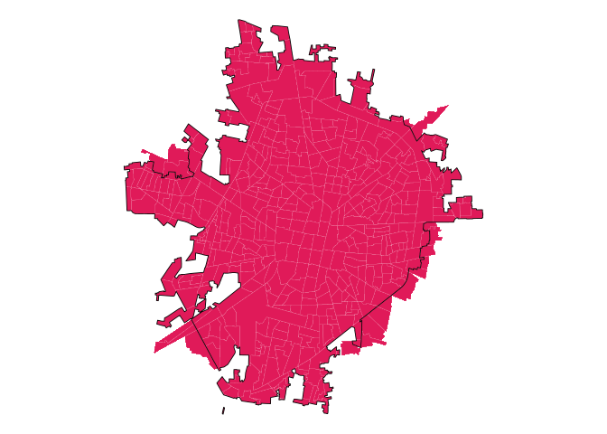
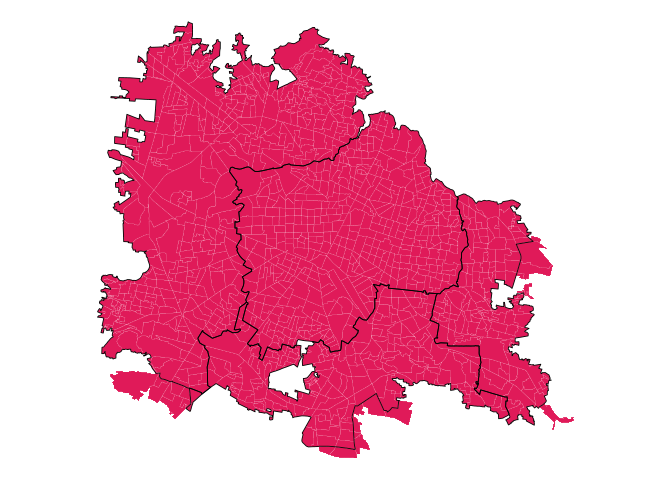

<!-- This file is generated from extract_ageb_en.Rmd.orig (see vignettes/precompile.R) -->


```r
library(rgeomex)
library(ggplot2)
```

`extract_ageb()` extracts the urban AGEB that intersect the boundary of a locality. It has two arguments: the state key (`cve_edo`) and the name of the locality (`locality`). It returns a list with two sf objects: `locality` (the boundary of the locality) and `ageb`.

Only the file of the requested state is downloaded.

## Mérida


```r
merida <- extract_ageb(cve_edo = "31", locality = "Merida")
nrow(merida$ageb)
#> [1] 498
```


```r
ggplot() +
  geom_sf(data = merida$ageb, fill = "#E01A59", col = "white", lwd = 0.05) +
  geom_sf(data = merida$locality, fill = NA, col = "black", lwd = 0.3) +
  theme_void()
```



## Guadalajara


```r
gdl <- extract_ageb(cve_edo = "14",
                  locality = c("Guadalajara", "Zapopan", "Tonalá", "Tlaquepaque"))
nrow(gdl$ageb)
#> [1] 1270
```


```r
ggplot() +
  geom_sf(data = gdl$ageb, fill = "#E01A59", col = "white", lwd = 0.05) +
  geom_sf(data = gdl$locality, fill = NA, col = "black", lwd = 0.3) +
  theme_void()
```



## Mexico City


```r
cdmx <- extract_ageb(cve_edo = "09", locality = "cdmx")
nrow(cdmx$ageb)
#> [1] 2431
```


```r
ggplot() +
  geom_sf(data = cdmx$ageb, fill = "#E01A59", col = "white", lwd = 0.05) +
  theme_void()
```


## Step by step

The same steps the function does:


```r
# 1. the locality
loc <- extract_locality(cve_edo = "31", locality = "Merida")

# 2. the dataset of the state
x <- rgeomex_load("AGEB_inegi_2019", cve_edo = "31") |>
  sf::st_make_valid()

# 3. what intersects the locality
x <- x[loc, ]
nrow(x)
#> [1] 498
```
