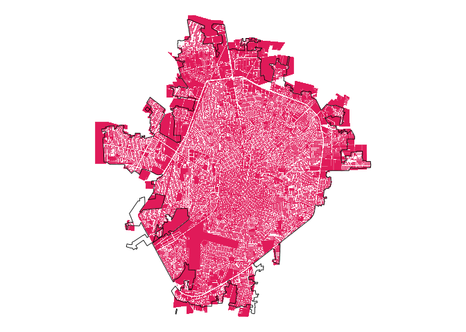
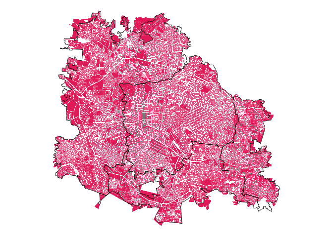
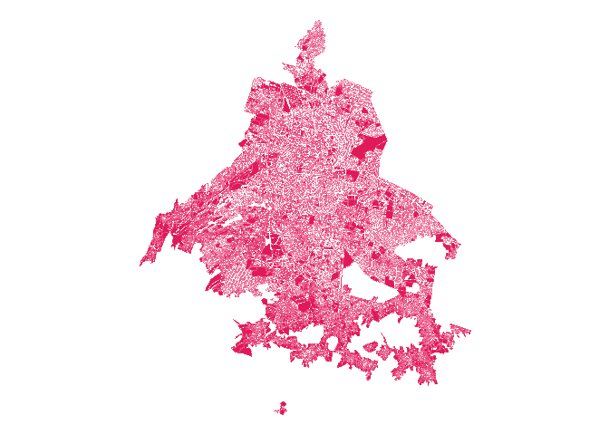

<!-- Este archivo se genera desde extract_blocks_es.Rmd.orig (ver vignettes/precompile.R) -->


```r
library(rgeomex)
library(ggplot2)
```

`extract_blocks()` extrae las manzanas que intersectan el polígono de una localidad. Tiene dos argumentos: la clave del estado (`cve_edo`) y el nombre de la localidad (`locality`). Regresa una lista con dos objetos sf: `locality` (el polígono de la localidad) y `block`.

Solo se descarga el archivo del estado que se pide.

## Mérida


```r
merida <- extract_blocks(cve_edo = "31", locality = "Merida")
nrow(merida$block)
#> [1] 15374
```


```r
ggplot() +
  geom_sf(data = merida$block, fill = "#E01A59", col = "white", lwd = 0.05) +
  geom_sf(data = merida$locality, fill = NA, col = "black", lwd = 0.3) +
  theme_void()
```

<div class="figure">

<p class="caption">plot of chunk merida_map</p>
</div>

## Guadalajara


```r
gdl <- extract_blocks(cve_edo = "14",
                  locality = c("Guadalajara", "Zapopan", "Tonalá", "Tlaquepaque"))
nrow(gdl$block)
#> [1] 39830
```


```r
ggplot() +
  geom_sf(data = gdl$block, fill = "#E01A59", col = "white", lwd = 0.05) +
  geom_sf(data = gdl$locality, fill = NA, col = "black", lwd = 0.3) +
  theme_void()
```

<div class="figure">

<p class="caption">plot of chunk guadalajara_map</p>
</div>

## Ciudad de México


```r
cdmx <- extract_blocks(cve_edo = "09", locality = "cdmx")
nrow(cdmx$block)
#> [1] 76407
```


```r
ggplot() +
  geom_sf(data = cdmx$block, fill = "#E01A59", col = "white", lwd = 0.05) +
  theme_void()
```

<div class="figure">

<p class="caption">plot of chunk cdmx_map</p>
</div>

## Con código

Los mismos pasos que hace la función:


```r
# 1. la localidad
loc <- extract_locality(cve_edo = "31", locality = "Merida")

# 2. la base del estado
x <- rgeomex_load("blocks_ine20_mx", cve_edo = "31") |>
  sf::st_make_valid()

# 3. lo que intersecta la localidad
x <- x[loc, ]
nrow(x)
#> [1] 15374
```
