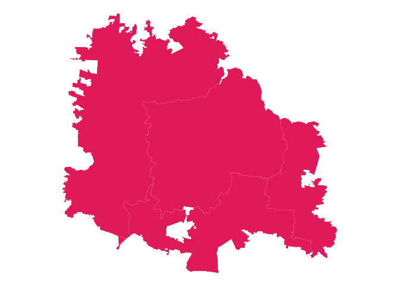
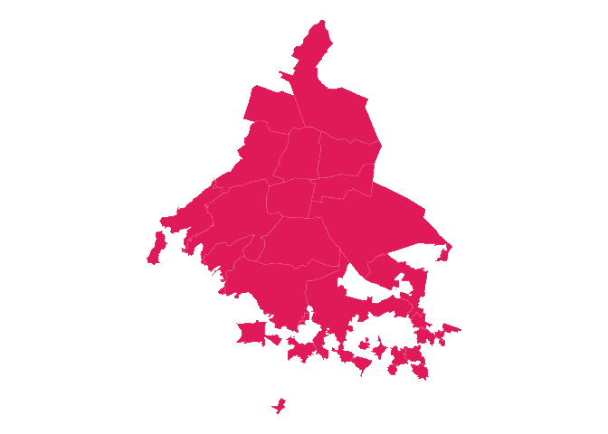

<!-- This file is generated from extract_locality_en.Rmd.orig (see vignettes/precompile.R) -->


```r
library(rgeomex)
library(ggplot2)
```

`extract_locality()` extracts the boundary of a locality. It has two arguments: the state key (`cve_edo`) and the name of the locality in INEGI (`locality`). Accents and capital letters do not matter: the most similar name is used. It returns a sf object.

The polygons are downloaded the first time they are used and kept in a local cache (`rgeomex_cache_dir()`); later they are read from the cache.


```r
acapulco <- extract_locality(cve_edo = "12", locality = "Acapulco de Juarez")
acapulco
#> Simple feature collection with 1 feature and 6 fields
#> Geometry type: MULTIPOLYGON
#> Dimension:     XY
#> Bounding box:  xmin: -100.0048 ymin: 16.71173 xmax: -99.69626 ymax: 16.93538
#> Geodetic CRS:  WGS 84
#>      CVEGEO CVE_ENT CVE_MUN CVE_LOC             NOMGEO AMBITO
#> 1 120010001      12     001    0001 Acapulco de Juárez Urbana
#>                         geometry
#> 1 MULTIPOLYGON (((-99.69861 1...
```


```r
ggplot() +
  geom_sf(data = acapulco, fill = "#E01A59", col = "white", lwd = 0.05) +
  theme_void()
```

<div class="figure">

<p class="caption">plot of chunk acapulco_map</p>
</div>

The `locality` argument accepts a vector with the localities of a metropolitan area:


```r
guadalajara <- extract_locality(cve_edo = "14",
                                locality = c("Guadalajara", "Zapopan",
                                             "Tlaquepaque", "Tonalá"))
guadalajara$NOMGEO
#> [1] "Guadalajara" "Tlaquepaque" "Tonalá"      "Zapopan"
```


```r
ggplot() +
  geom_sf(data = guadalajara, fill = "#E01A59", col = "white", lwd = 0.05) +
  theme_void()
```

<div class="figure">

<p class="caption">plot of chunk guadalajara_map</p>
</div>

For Mexico City (`cve_edo = "09"`) all its localities are returned:


```r
cdmx <- extract_locality(cve_edo = "09", locality = "cdmx")
nrow(cdmx)
#> [1] 33
```


```r
ggplot() +
  geom_sf(data = cdmx, fill = "#E01A59", col = "white", lwd = 0.05) +
  theme_void()
```

<div class="figure">

<p class="caption">plot of chunk cdmx_map</p>
</div>

The whole datasets are loaded with `rgeomex_load()`; `rgeomex_datasets()` lists them:


```r
rgeomex_datasets()
#>                     dataset by_state geometry
#> 1           AGEE_inegi19_mx    FALSE     TRUE
#> 2           AGEM_inegi19_mx    FALSE     TRUE
#> 3           AGEM_inegi25_mx    FALSE     TRUE
#> 4            loc_inegi19_mx    FALSE     TRUE
#> 5                    hrl_mx    FALSE     TRUE
#> 6                    pua_mx    FALSE     TRUE
#> 7                     ua_mx    FALSE     TRUE
#> 8             iter_2020_loc    FALSE    FALSE
#> 9           AGEB_inegi_2019     TRUE     TRUE
#> 10          blocks_ine20_mx     TRUE     TRUE
#> 11 blocks_ine20_mx_centroid     TRUE     TRUE
#> 12        sectores_ine20_mx     TRUE     TRUE
yucatan <- rgeomex_load("AGEM_inegi19_mx", cve_edo = "31")
nrow(yucatan)
#> [1] 106
```
